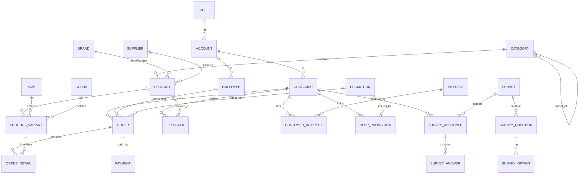
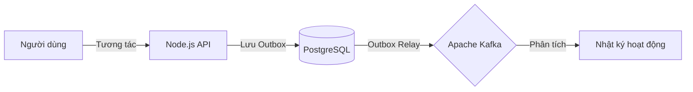

# ĐỒ ÁN MÔN HỆ THỐNG THÔNG TIN DOANH NGHIỆP

**Đề tài:** Hệ thống Quản trị Cửa hàng Thời trang "Hung Fashion"

---

## 1. GIỚI THIỆU VỀ DOANH NGHIỆP 

### 1.1. Giới thiệu chung
**Hung Fashion** là thương hiệu thời trang hiện đại chuyên cung cấp các dòng sản phẩm may mặc đa dạng từ áo thun, sơ mi, quần jean đến các loại phụ kiện thời trang. Với mục tiêu trở thành chuỗi cửa hàng dẫn đầu về trải nghiệm khách hàng, doanh nghiệp không chỉ chú trọng vào chất lượng sản phẩm mà còn tập trung vào việc cá nhân hóa dịch vụ thông qua công nghệ.

### 1.2. Hoạt động và mô hình kinh doanh
*   **Mô hình:** Bán lẻ đa kênh (Omnichannel), kết hợp giữa cửa hàng truyền thống (In-store) và nền tảng trực tuyến (Website/Online).
*   **Hoạt động chính:**
    *   Quản lý chuỗi cung ứng: Làm việc với các nhà cung cấp và thương hiệu thời trang.
    *   Quản lý kho: Kiểm soát hàng hóa theo biến thể chi tiết (Size, Màu sắc).
    *   Kinh doanh và Marketing: Thực hiện các chương trình khuyến mãi, quản lý đơn hàng.
    *   Chăm sóc khách hàng (CRM): Thu thập phản hồi, khảo sát và xây dựng chương trình khách hàng thân thiết.

### 1.3. Cơ cấu nhân sự
Doanh nghiệp được tổ chức theo mô hình chuyên môn hóa:
*   **Ban Giám đốc (ADMIN):** Quản trị toàn diện, đưa ra chiến lược kinh doanh dựa trên báo cáo.
*   **Bộ phận Nhân sự (QL_NHAN_SU):** Quản lý hồ sơ nhân viên, ca làm việc.
*   **Bộ phận Kho (QL_KHO):** Quản lý nhập/xuất, điều chuyển hàng hóa và nhà cung cấp.
*   **Bộ phận Bán hàng (QL_BAN_HANG):** Quản lý đơn hàng, doanh thu và các chương trình khuyến mãi.
*   **Bộ phận CSKH (QL_KHACH_HANG):** Quản lý dữ liệu khách hàng, khảo sát và giải quyết khiếu nại.

---

## 2. KHẢO SÁT HỆ THỐNG THÔNG TIN DOANH NGHIỆP 

### 2.1. Phân tích hiện trạng
Trước khi xây dựng hệ thống mới, việc quản lý tại Hung Fashion gặp nhiều khó khăn:
*   Dữ liệu khách hàng bị phân mảnh, không theo dõi được lịch sử tương tác.
*   Việc quản lý tồn kho dễ sai sót do sự đa dạng về kích thước và màu sắc.
*   Thiếu công cụ phân tích dữ liệu thời gian thực để ra quyết định nhập hàng.

### 2.2. Yêu cầu đối với hệ thống mới
Hệ thống thông tin mới cần đáp ứng:
1.  **Tính tập trung:** Quản lý mọi phân hệ (Nhân sự, Kho, Bán hàng, CRM) trên một nền tảng duy nhất.
2.  **Tính bảo mật (RBAC):** Phân quyền chặt chẽ cho từng bộ phận chuyên trách.
3.  **Khả năng theo dõi (Audit Log):** Ghi lại mọi hành vi người dùng để đảm bảo tính minh bạch và an toàn dữ liệu.
4.  **Kiến trúc hiện đại:** Sử dụng Event-Driven (Kafka) để xử lý dữ liệu lớn và không đồng bộ, giúp hệ thống hoạt động mượt mà khi có lượng giao dịch cao.

---

## 3. KIẾN TRÚC HỆ THỐNG KỸ THUẬT

### 3.1. Phân quyền người dùng (Role-Based Access Control)
Hệ thống được thiết kế theo mô hình phân quyền phân cấp:
*   **Quản trị hệ thống (ADMIN):** Toàn quyền kiểm soát, cấu hình hệ thống và xem Audit Log.
*   **Quản lý chức năng (QL_...):** Truy cập theo phạm vi bộ phận chuyên trách.
*   **Khách hàng:** Portal riêng để mua sắm và gửi khảo sát.

### 3.2. Sơ đồ cơ sở dữ liệu (ERD)
Sơ đồ thực thể mối quan hệ chi tiết của toàn bộ hệ thống Hung Fashion:

### 3.3. Từ điển dữ liệu (Data Dictionary)

| STT | Tên bảng | Mô tả chi tiết chức năng | Khóa chính / Khóa ngoại chính |
| :--- | :--- | :--- | :--- |
| 1 | `role` | Quản lý danh sách vai trò (Admin, Quản lý kho, Khách hàng,...) | `role_id` |
| 2 | `permission` | Danh sách quyền hạn chi tiết trong hệ thống | `permission_id` |
| 3 | `role_permission` | Bảng trung gian phân quyền cho từng vai trò | `role_id`, `permission_id` |
| 4 | `account` | Lưu thông tin tài khoản đăng nhập, mật khẩu mã hóa, trạng thái | `account_id`, FK: `role_id` |
| 5 | `employee` | Lưu hồ sơ chi tiết nhân viên (vị trí, liên hệ,...) | `employee_id`, FK: `account_id` |
| 6 | `customer` | Lưu thông tin khách hàng, điểm tích lũy, hạng thành viên (VIP, Gold,...) | `customer_id`, FK: `account_id` |
| 7 | `interest` | Danh mục các sở thích thời trang | `interest_id` |
| 8 | `customer_interest` | Bảng trung gian lưu sở thích của từng khách hàng | `customer_id`, `interest_id` |
| 9 | `brand` | Thương hiệu thời trang | `brand_id` |
| 10 | `category` | Danh mục sản phẩm (hỗ trợ phân cấp cha - con) | `category_id`, FK: `parent_id` |
| 11 | `supplier` | Nhà cung cấp sản phẩm | `supplier_id` |
| 12 | `product` | Sản phẩm chính (tên, mô tả, giá nhập, giá bán) | `product_id`, FK: `category_id`, `brand_id`, `supplier_id` |
| 13 | `size` | Danh mục kích thước (S, M, L, XL, 28, 30,...) | `size_id` |
| 14 | `color` | Danh mục màu sắc và mã màu HEX | `color_id` |
| 15 | `product_variant` | Biến thể sản phẩm (kết hợp Size + Màu + Tồn kho + SKU) | `variant_id`, FK: `product_id`, `size_id`, `color_id` |
| 16 | `product_image` | Danh sách hình ảnh chi tiết của sản phẩm | `image_id`, FK: `product_id` |
| 17 | `import_receipt` | Phiếu kho (Nhập/Xuất/Điều chuyển) | `receipt_id`, FK: `supplier_id`, `employee_id` |
| 18 | `import_detail` | Chi tiết sản phẩm trong phiếu kho | `detail_id`, FK: `receipt_id`, `variant_id` |
| 19 | `promotion` | Chương trình khuyến mãi / Mã giảm giá | `promotion_id` |
| 20 | `user_promotion` | Quản lý mã giảm giá được cấp cho từng khách hàng | `user_promo_id`, FK: `customer_id`, `promotion_id` |
| 21 | `order` | Đơn hàng (khách mua, nhân viên xử lý, tổng tiền, trạng thái) | `order_id`, FK: `customer_id`, `employee_id`, `promotion_id` |
| 22 | `order_detail` | Chi tiết sản phẩm mua trong đơn hàng | `detail_id`, FK: `order_id`, `variant_id` |
| 23 | `payment` | Quản lý giao dịch thanh toán (tiền mặt, Momo, VNPay,...) | `payment_id`, FK: `order_id` |
| 24 | `feedback` | Phản hồi, khiếu nại, đánh giá của khách hàng | `feedback_id`, FK: `customer_id`, `product_id`, `order_id`, `employee_id` |
| 25 | `survey` | Khảo sát ý kiến khách hàng theo điều kiện (hạng, giới tính, độ tuổi) | `survey_id`, FK: `created_by` |
| 26 | `survey_question` | Câu hỏi trong bảng khảo sát | `question_id`, FK: `survey_id` |
| 27 | `survey_option` | Các lựa chọn cho câu hỏi trắc nghiệm | `option_id`, FK: `question_id` |
| 28 | `survey_response` | Phiên trả lời khảo sát của khách hàng | `response_id`, FK: `survey_id`, `customer_id` |
| 29 | `survey_invitation` | Lời mời tham gia khảo sát gửi tới khách hàng | `invitation_id`, FK: `survey_id`, `customer_id` |
| 30 | `survey_answer` | Câu trả lời chi tiết của khách hàng cho từng câu hỏi | `answer_id`, FK: `response_id`, `question_id`, `option_id` |
| 31 | `user_events` | Bảng lưu trữ nhật ký sự kiện người dùng đồng bộ từ Kafka | `id` |
| 32 | `transactions` | Bảng lưu trữ sự kiện giao dịch từ Kafka | `id` |
| 33 | `outbox_events` | Bảng trung gian theo Outbox Pattern đảm bảo độ tin cậy gửi Kafka | `event_id` |

### 3.4. Kiến trúc luồng dữ liệu (Event-Driven)
Hệ thống sử dụng Outbox Pattern kết hợp Kafka để xử lý nhật ký hoạt động người dùng, đảm bảo dữ liệu không bị mất mát ngay cả khi hệ thống chịu tải cao:

---

## 4. CÁC PHÂN HỆ CHÍNH

### 4.1. Quản lý Khách hàng (CRM)
*   Theo dõi sở thích, hạng khách hàng và lịch sử tương tác.
*   Hệ thống khảo sát tự động được gửi tới khách hàng dựa trên điều kiện (hạng khách hàng, ngày mua gần nhất).

### 4.2. Quản lý kho & Đơn hàng
*   **Tồn kho thông minh:** Quản lý hàng hóa theo biến thể (Size/Color).
*   **Xử lý đơn hàng:** Sử dụng State Machine để kiểm soát luồng trạng thái (Pending -> Shipped -> Delivered/Cancelled).

### 4.3. Nhật ký hoạt động (Audit Log)
*   Tính năng nhật ký hoạt động được xây dựng dựa trên luồng sự kiện Kafka, cho phép Admin theo dõi mọi hành vi click chuột và thao tác của người dùng trong hệ thống.

---

## 5. KẾT QUẢ ĐẠT ĐƯỢC

### 5.1. Dashboard Quản trị
Dashboard cung cấp cái nhìn tổng quan về doanh thu, tỷ lệ khách hàng theo hạng, và các chỉ số CRM quan trọng thông qua biểu đồ thời gian thực.

### 5.2. Khả năng mở rộng
Kiến trúc Event-Driven giúp hệ thống dễ dàng tích hợp thêm các dịch vụ mới (như Recommendation Engine hoặc Loyalty Service) mà không ảnh hưởng đến luồng nghiệp vụ chính.

---

## 6. KẾT LUẬN
Hệ thống "Hung Fashion" đã hoàn thành mục tiêu xây dựng một nền tảng quản trị thời trang hiện đại, có tính ứng dụng thực tế cao, khả năng mở rộng nhờ kiến trúc Event-Driven và độ an toàn dữ liệu nhờ tuân thủ nguyên tắc nghiệp vụ của Hệ thống thông tin doanh nghiệp.
