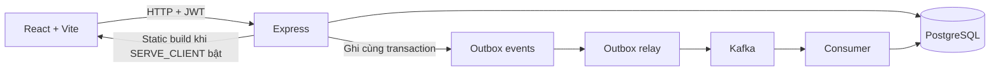

# Hung Fashion CRM — báo cáo và hướng dẫn dự án

> Tài liệu này mô tả những gì kiểm chứng được từ mã nguồn, schema, migration và seed script trong repository. Các thông tin về doanh nghiệp thật, khảo sát, đóng góp thành viên và kiểm thử thực tế được đánh dấu **CẦN BỔ SUNG**; không dùng dữ liệu demo để thay thế bằng chứng thực tế.

## 1. Mục tiêu và phạm vi

Hung Fashion CRM là ứng dụng quản lý bán lẻ thời trang và chăm sóc khách hàng. Hệ thống hiện có dashboard quản trị theo vai trò, tài khoản và phân quyền, khách hàng, nhân viên, sản phẩm, nhà cung cấp, tồn kho, đơn hàng, khuyến mãi, phản hồi, khảo sát, chat CSKH, báo cáo, nhật ký hoạt động và cổng tự phục vụ khách hàng.

Báo cáo giữa kỳ chọn **CRM** cho mục III trong phiếu đánh giá học phần. Hệ thống có hồ sơ khách hàng, sở thích, phản hồi, khảo sát, phân nhóm/báo cáo và chat. Đây là đối chiếu phạm vi từ code; chưa phải nghiệm thu nghiệp vụ tại doanh nghiệp. Không có module HRM đầy đủ về nghỉ phép/chấm công/lương hoặc MRP/BOM trong mã nguồn hiện tại.

Thanh toán QR demo là mô phỏng, không kết nối ngân hàng và không nhận tiền thật. Không bật hoặc giới thiệu luồng demo như thanh toán thật.

## 2. Tài liệu bàn giao

- Báo cáo LaTeX: [`docs/report/main.tex`](docs/report/main.tex).
- Bản PDF được biên dịch: [`docs/report/main.pdf`](docs/report/main.pdf) (nếu đã tạo bằng XeLaTeX).
- Chương báo cáo, sơ đồ Mermaid, kiểm kê route/schema và danh sách thông tin cần bổ sung: [`docs/report/`](docs/report/).
- Schema ghép để tra cứu: [`database/schema.sql`](database/schema.sql); dữ liệu tham chiếu tĩnh: [`database/demo_data.sql`](database/demo_data.sql).
- Checklist đóng gói: [`submission/SUBMISSION-CHECKLIST.md`](submission/SUBMISSION-CHECKLIST.md).
- Hướng dẫn PostgreSQL backup/restore: [`recoverydb.md`](recoverydb.md).

## 3. Vai trò hệ thống

| Role | Phạm vi chính |
|---|---|
| `ADMIN` | Quản trị hệ thống và các module quản lý |
| `QL_NHAN_SU` | Nhân viên và báo cáo được cấp quyền |
| `QL_KHO` | Sản phẩm, tồn kho, nhà cung cấp, phiếu kho |
| `QL_BAN_HANG` | Đơn hàng, khuyến mãi và bán hàng |
| `QL_KHACH_HANG` | CRM, phản hồi, khảo sát, chat CSKH |
| `KHACH_HANG` | Catalog, đơn của mình, hồ sơ, đánh giá, khảo sát, voucher, loyalty và chat của mình |

Danh sách route API, cột schema, chỉ mục, role navigation và ma trận rubric có trong [`docs/report/00-inventory.md`](docs/report/00-inventory.md). Kiểm tra quyền API vẫn phải thực hiện ở backend; menu giao diện không phải biện pháp bảo vệ.

## 4. Kiến trúc



Ứng dụng dùng JavaScript/React/Vite, Express, PostgreSQL và KafkaJS. Frontend ở `store-admin/client`; server ở `store-admin/server`. Môi trường phát triển local có Docker Compose cho PostgreSQL/Kafka. Kafka UI là tiện ích quan sát local. Các sơ đồ chi tiết Mermaid trong `docs/report/diagrams/` lấy từ module và luồng trong source.

## 5. Yêu cầu môi trường và khởi chạy local

Cần Node.js/npm, Docker Desktop nếu chạy PostgreSQL/Kafka bằng Compose và PostgreSQL client tools nếu dùng backup/restore ngoài Docker. Dùng PowerShell:

```powershell
Set-Location .\store-admin
npm install
# Tạo server/.env cục bộ theo nhu cầu; không commit file này.
npm run dev:local
```

Lệnh `dev:local` khởi động service PostgreSQL/Kafka theo Compose local rồi chạy Vite và Express. Có thể chạy riêng `docker compose --env-file server/.env.example up -d postgres kafka`, sau đó `npm run dev`. `.env.example` là mẫu biến cho Compose; công cụ chỉ tự đọc file tên `.env` khi được cấu hình như vậy. Docker Compose không tự đổi tên `.env.example` thành `.env`.

Lệnh build và server:

```powershell
npm run build
npm start
```

Để migration tự động chạy khi khởi động server hoặc chạy rõ ràng:

```powershell
npm run db:migrate --workspace server
```

## 6. Cấu hình và secrets

Tên biến được lấy từ `store-admin/server/.env.example` và phần đọc config trong code. README chỉ nêu tên/chức năng, không sao chép giá trị môi trường. Hãy tạo giá trị riêng cho từng môi trường và lưu bí mật ở secret manager; không commit `.env`, private key, certificate, token hay backup có dữ liệu cá nhân.

| Nhóm | Biến môi trường |
|---|---|
| HTTP/auth | `PORT`, `LOCAL_HOST`, `JWT_SECRET`, `TRUST_PROXY_HOPS` |
| Giới hạn auth/event | `AUTH_RATE_LIMIT_WINDOW_MS`, `AUTH_LOGIN_RATE_LIMIT_MAX`, `AUTH_REGISTER_RATE_LIMIT_MAX`, `EVENT_RATE_LIMIT_WINDOW_MS`, `EVENT_RATE_LIMIT_MAX`, `OUTBOX_MAX_BACKLOG` |
| PostgreSQL | `POSTGRES_HOST`, `POSTGRES_PORT`, `POSTGRES_DB`, `POSTGRES_USER`, `POSTGRES_PASSWORD`, `POSTGRES_SSL`, `POSTGRES_CA_PATH` |
| PostgreSQL tools | `PG_DUMP_PATH`, `PG_RESTORE_PATH` |
| Kafka | `KAFKA_BROKER`, `KAFKA_BROKERS`, `KAFKA_SSL_CA`, `KAFKA_SSL_CA_PATH`, `KAFKA_SSL_CERT`, `KAFKA_SSL_CERT_PATH`, `KAFKA_SSL_KEY`, `KAFKA_SSL_KEY_PATH`, `KAFKA_UI_PORT` |
| Tính năng/triển khai | `DEMO_PAYMENT`, `PUBLIC_BASE_URL`, `SERVE_CLIENT`, `ENABLE_DATABASE_BROWSER`, `ENABLE_DATABASE_RESTORE` |
| Khác | `PYTHON_EXECUTABLE`, `DEBUG_CHAT_SSE`, `CHAT_UPLOAD_DIR`, `KAFKA_DB_CONFIRM_TIMEOUT_MS` |

Biến cần thêm hoặc đổi theo môi trường managed phải đặt trong cấu hình deploy, không chép secret vào README. Local `TRUST_PROXY_HOPS` nên là `0`; chỉ đặt số hop proxy sau khi xác minh IP client thật. `POSTGRES_SSL`/CA và Kafka TLS dùng khi dịch vụ managed yêu cầu.

## 7. PostgreSQL, migrations và dữ liệu mẫu

Baseline DDL nằm ở `store-admin/server/sql/schema.sql`; các migration có phiên bản nằm trong `store-admin/server/sql/migrations/`. Migration runner dùng bảng theo dõi phiên bản và chạy migration tuần tự. `database/schema.sql` là bản ghép để xem xét/nộp tài liệu, không thay thế migration runner.

Dữ liệu tham chiếu an toàn được tách trong `database/demo_data.sql`. Seed ứng dụng đầy đủ hơn nằm trong `store-admin/scripts/seed.mjs`; cần catalog JSON ở `store-admin/data/clean/products.json`, và một số dữ liệu được dựng qua script/scraper. Chỉ chạy seed trên database local/test đã xác nhận:

```powershell
npm run seed
```

Seed có tài khoản demo và dữ liệu thử nghiệm; không đưa mật khẩu hoặc hash vào tài liệu. Seed không đảm bảo mọi bảng đều có bản ghi — ví dụ chat, event pipeline và token demo phụ thuộc thao tác. Xem [`docs/report/TODO-can-bo-sung.md`](docs/report/TODO-can-bo-sung.md) trước khi tuyên bố đã có đủ dữ liệu.

## 8. Outbox, Kafka và sự kiện giao dịch

Các topic được code sử dụng là `user-events` và `transaction-events`; consumer group là `store-admin-group`. Request nghiệp vụ ghi sự kiện vào `outbox_events`; relay gửi batch lên Kafka rồi đánh dấu bản ghi đã publish. Nếu tiến trình dừng sau khi broker nhận message nhưng trước khi database đánh dấu, relay có thể gửi lại; consumer idempotent theo `event_id` để không tạo bản ghi trùng trong bảng đích.

Topic/ACL phải được phép trên broker. Repository có thể khởi tạo topic tùy quyền của Kafka cluster; trên dịch vụ managed, hãy kiểm tra ACL/quota hoặc tạo topic theo quy trình nhà cung cấp. Không có một con số throughput/free-tier cố định áp dụng cho mọi cluster. Kiểm tra quota hiện tại trong console và ghi kết quả đo của môi trường thật; script benchmark không phải chứng nhận hiệu năng.

```powershell
npm run benchmark:kafka -- 5 30
```

Nếu gặp thông báo giới hạn số topic (chẳng hạn quota 5 topic của một gói cụ thể), kiểm tra topic hiện hữu và quota trong console; không xóa topic trước khi xác nhận dữ liệu và phụ thuộc consumer.

## 9. QR thanh toán DEMO

Luồng DEMO chỉ dùng khi cấu hình demo được bật. Server sinh token ngẫu nhiên, lưu hash, hết hạn sau 15 phút; URL QR không chứa order ID. Điện thoại phải truy cập được `PUBLIC_BASE_URL` qua IP LAN hoặc tunnel, và server phải bind trên địa chỉ reachable. Trang xác nhận hiển thị “DEMO - không phải giao dịch thật”. Đây không phải tích hợp ngân hàng, không tự phát hiện tiền chuyển khoản và không được dùng để đối soát tiền thật.

## 10. Backup và restore

Script backup/restore cục bộ nằm trong `store-admin/scripts/` và chỉ cho phép database host là localhost/loopback. Backup ghi vào `store-admin/backups/`; restore dùng `pg_restore --clean --if-exists` nên có thể thay thế schema/database đích. Chỉ restore lên database test đã xác nhận; tuyệt đối không thử trên database production.

```powershell
npm run db:backup
npm run db:restore -- backups/<file>.dump
```

Cần diễn tập restore trên DB test và ghi kết quả/thời gian trước khi báo cáo khả năng phục hồi. Hướng dẫn chi tiết thêm ở [`recoverydb.md`](recoverydb.md).

## 11. Test và kiểm tra

```powershell
Set-Location .\store-admin\server
npm test
```

Test hiện dùng `node:test`. Để build frontend, chạy `npm run build` tại thư mục `store-admin`. Chỉ đưa vào báo cáo những test đã chạy thực tế cùng ngày, lệnh, kết quả và môi trường. Không suy diễn test pass từ sự tồn tại của test file.

## 12. Biên dịch báo cáo LaTeX

Cần XeLaTeX (TeX Live/MiKTeX) và font Times New Roman. Từ thư mục báo cáo:

```powershell
Set-Location .\docs\report
xelatex -interaction=nonstopmode -halt-on-error main.tex
xelatex -interaction=nonstopmode -halt-on-error main.tex
```

Chạy hai lượt để cập nhật mục lục/tham chiếu. Sơ đồ Mermaid có source `.mmd`; nếu đã có Mermaid CLI, render PDF bằng `mmdc` theo hướng dẫn trong phụ lục rồi biên dịch lại. Các ô `[CẦN BỔ SUNG]` là dữ liệu thực nhóm/cán bộ phải thay trước khi nộp; không để nguyên trong bản chính thức.

## 13. Những thông tin cần hoàn tất trước khi nộp

1. Tên nhóm/đề tài chính thức, lớp, giảng viên, thành viên/MSSV, đóng góp, tự đánh giá, chữ ký và kế hoạch tuần đã thực hiện.
2. Tên pháp lý, địa chỉ, năm thành lập, quy mô/cơ cấu và mô hình thực tế của Hung Fashion; xác nhận các giả định trong báo cáo.
3. Khảo sát có thật: người tham gia, số phiếu hợp lệ, thời gian, phương pháp, kết quả và kết luận; không dùng dữ liệu seed.
4. Kết xuất Mermaid thành ảnh và kiểm tra sơ đồ; thay tất cả khung ảnh giao diện bằng ảnh chụp thật, che dữ liệu cá nhân.
5. Chạy kiểm thử chức năng/phân quyền, build/test; ghi ngày, môi trường, người chạy, kết quả và lỗi.
6. Bổ sung restore drill; xác minh quota/ACL/topic và giới hạn dịch vụ đúng gói đang dùng.
7. Xác nhận seed/data coverage; nếu yêu cầu mọi bảng có dữ liệu thì bổ sung seed thử nghiệm an toàn và ghi chính xác bảng còn trống.
8. Hoàn thành checklist đóng gói trong `submission/SUBMISSION-CHECKLIST.md`; xóa secrets, dump dữ liệu và artifacts không được yêu cầu khỏi source archive.

Chi tiết TODO có checklist tại [`docs/report/TODO-can-bo-sung.md`](docs/report/TODO-can-bo-sung.md).

Mermaid source có bản gom tại [docs/report/diagram-source.md](docs/report/diagram-source.md).
