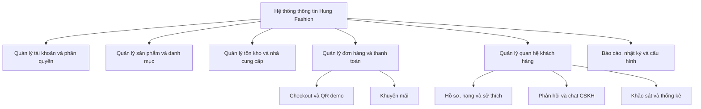
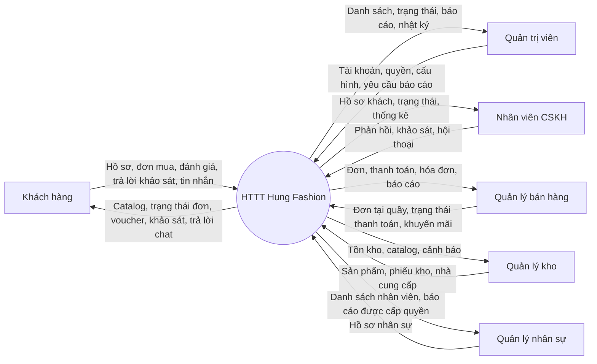
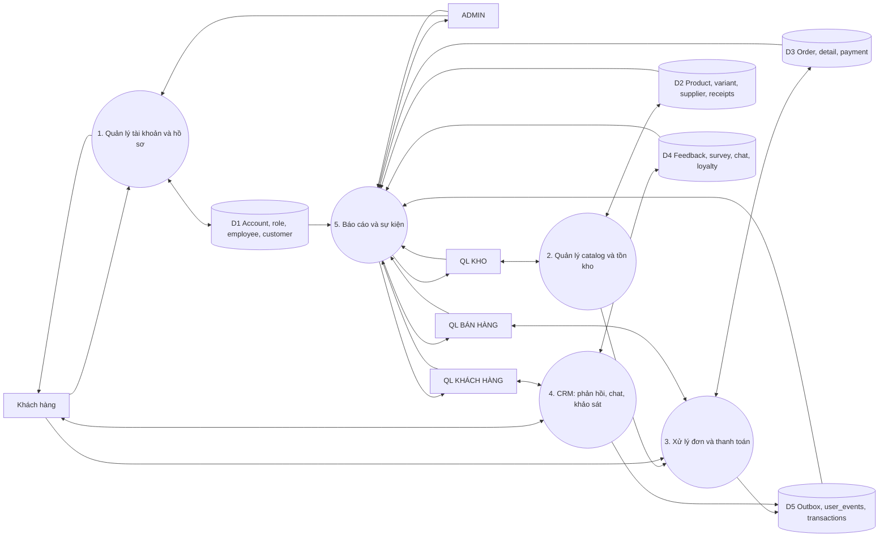
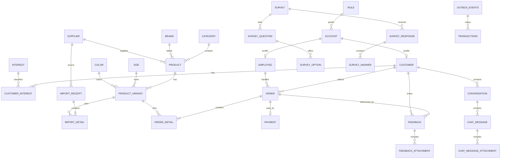
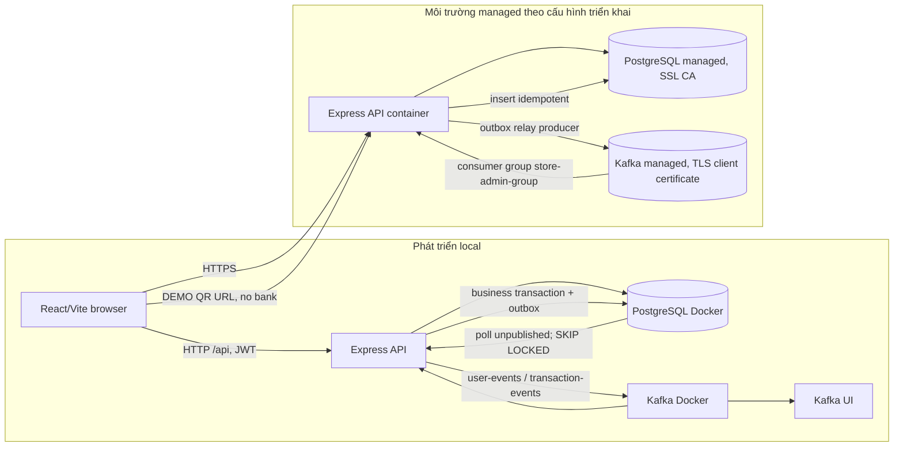

# Ngu?n Mermaid c?a c?c s? ?? b?o c?o

C?c t?p `.mmd` d??i ??y l? m? ngu?n Mermaid ???c ??i chi?u v?i repository. Khi c? Mermaid CLI, xu?t m?i t?p th?nh PDF c?nh ngu?n r?i bi?n d?ch `main.tex` l?i.

## 01-chuc-nang.mmd

## 02-ngu-canh.mmd

## 03-dfd-muc-0.mmd

## 04-erd.mmd

## 05-trien-khai-su-kien.mmd

